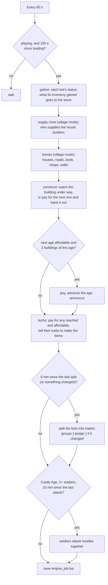
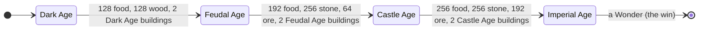
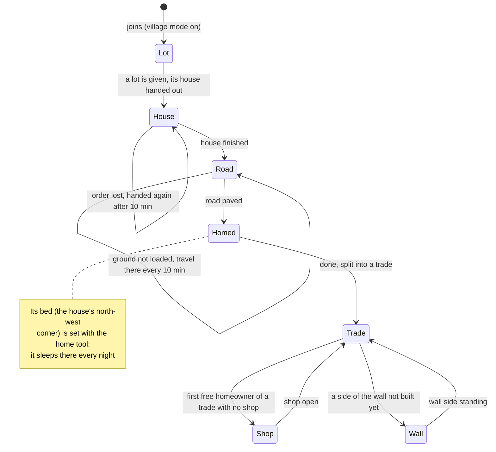

# Empire and village mode

An optional computer player in the style of Age of Empires II. It runs the whole team: it counts what the
bots gather, pays for ages and technologies, decides each bot's trade, has buildings put up in a town and,
in **village mode**, has every bot build a house of its own first, then shops and a wall around the
village. Everything here is read from `bot/plugins/empire.lua`, with the parts of `roles.lua`, `groups.lua`,
`brain.lua` and `migrate.lua` that work with it.

## Contents

1. [Starting and stopping](#1-starting-and-stopping)
2. [The minute loop](#2-the-minute-loop)
3. [Resources](#3-resources)
4. [Ages](#4-ages)
5. [Technologies](#5-technologies)
6. [Who does what: the split](#6-who-does-what-the-split)
7. [Buildings](#7-buildings)
8. [The town and its lots](#8-the-town-and-its-lots)
9. [Village mode](#9-village-mode)
10. [Attacks](#10-attacks)
11. [How build orders work](#11-how-build-orders-work)
12. [Saving and restarts](#12-saving-and-restarts)
13. [Migration](#13-migration)
14. [The tool](#14-the-tool)
15. [Constants](#15-constants)
16. [Known limits and quirks](#16-known-limits-and-quirks)

---

## 1. Starting and stopping

| How | What happens |
|---|---|
| `./run.sh --empire ...` | `BOTCRAFT_EMPIRE=1`: plays from the start, 150 s after the plugins load (once the bots are in) |
| `./run.sh --village ...` | `BOTCRAFT_EMPIRE=village`: the same, in village mode |
| `empire { start = true }` | plays (and keeps playing after a restart, since the state is saved) |
| `empire { village = true }` | switches village mode on (starting play if it was off) |
| `empire { stop = true }` | stops; the groups stay as they are and the brain works again if it was working |

**Starting:**
- Stops the brain (the trade network, see [neural-network.md](neural-network.md)) and remembers whether it
  was on.
- Takes over the current groups from the groups plugin, so few bots change trade.

**Stopping:** gives the trade choice back to the brain. The roles plugin's action networks keep picking
each bot's actions and keep learning the whole time, in either mode.

Village mode can only be switched **on**. `state.village` stays set, and with `--village` the timer turns it
back on if it is missing.

---

## 2. The minute loop

Once a minute (`bot.every(60)`), unless the bots are migrating:



Anything that changes the team, such as an age reached, a building finished or a house done, sets the next
split due straight away instead of in 5 minutes.

---

## 3. Resources

Four resources, counted from the bots' **inventories**. Each minute, whatever a bot carries above what it
carried at the previous look is added to the stock. Nothing is subtracted when items leave the inventory.

| Resource | Items |
|---|---|
| food | bread, apple, carrot, potato, beetroot, wheat, sweet berries, melon slice, raw beef, porkchop, mutton, chicken, rabbit, cod, salmon, and anything `cooked_*` |
| wood | anything ending in `_log` or `_stem` |
| stone | cobblestone, cobbled deepslate, stone, deepslate, granite, diorite, andesite |
| ore | coal, raw iron, raw copper, raw gold, diamond, redstone, lapis lazuli, emerald |

The stock is spent on ages, technologies and buildings, like resources in Age of Empires. It is a score: the
items themselves stay with the bots.

---

## 4. Ages



Houses don't count among the two buildings. Each age is announced in the chat (`[empire] we reached the
Feudal Age!`).

Each age has its own **mix**: how many of every 15 bots work in each trade. It is scaled to the number of
bots (section 6).

| Trade | Dark | Feudal | Castle | Imperial |
|---|---|---|---|---|
| farmers | 3 | 3 | 2 | 2 |
| bakers | 2 | 2 | 2 | 2 |
| butchers | 2 | 2 | 2 | 1 |
| builders | 4 | 3 | 3 | 3 |
| miners | 2 | 3 | 3 | 2 |
| blacksmiths | 1 | 1 | 1 | 1 |
| explorers | 1 | 0 | 0 | 1 |
| soldiers | 0 | 1 | 2 | 3 |
| fishers | 1 | 1 | 1 | 1 |
| lumberjacks | 2 | 2 | 2 | 2 |
| carpenters | 1 | 1 | 1 | 1 |

Lumberjacks and carpenters are added at 2 and 1 in every age. On top of the mix, the resource the next age
lacks most (in proportion to its cost) gets **+2 weight** for each trade that brings it in:

| Resource short | Trades given +2 |
|---|---|
| food | farmers, bakers, fishers |
| wood | lumberjacks, carpenters |
| stone | builders, miners |
| ore | miners |

---

## 5. Technologies

Bought once their age is reached and the stock covers them. Each tells every bot of one trade to make
something:

| Technology | Age | Cost | Who | Makes (each) |
|---|---|---|---|---|
| Stone Tools | Feudal | 32 wood, 48 stone | blacksmiths | 4 stone pickaxes |
| Bloomery | Feudal | 48 wood, 16 ore | blacksmiths | 16 iron ingots |
| Iron Tools | Castle | 48 ore | blacksmiths | 3 iron pickaxes |
| Scale Mail | Castle | 64 food, 32 ore | soldiers | 1 iron chestplate |
| Blast Furnace | Imperial | 64 food, 64 ore | soldiers | 1 iron sword |
| Plate Mail | Imperial | 96 ore | soldiers | 1 iron leggings |

A technology waits while its trade has no bot.

---

## 6. Who does what: the split

Every 5 minutes, or sooner after a change, the leader splits the bots into trades:

1. **Targets.** The age's mix plus the resource bonus is turned into whole numbers of bots per trade by
   the largest-remainder method. With 15 bots it is the mix itself; with more, each share grows in
   proportion.
2. **Kept places.** A bot keeps the trade it already has. A bot that has none yet is placed by priority:
   - the leader is a builder;
   - the berry picker (berries plugin) is a farmer;
   - the castle plugin's explorer is an explorer;
   - in village mode, the supply crew get their supply trade (section 9).
3. **Fit.** Every other bot is scored for every trade by what it carries (+1 for each matching item end),
   and the best (bot, trade) pairs fill the trades still under target:

   | Trade | Items that fit |
   |---|---|
   | lumberjacks | `_axe`, `_log`, `_sapling` |
   | carpenters | `_planks`, `_stairs`, chest, stick |
   | soldiers | `_sword`, `_chestplate`, `_helmet`, shield, plus health / 10 |
   | miners | `_pickaxe`, torch, raw iron, coal |
   | farmers | `_hoe`, wheat seeds, egg, milk bucket, pumpkin |
   | butchers | beef, porkchop, mutton, leather, shears, wool |
   | bakers | wheat, bread, pumpkin pie, cake |
   | builders | cobblestone, `_planks`, `_log` |
   | blacksmiths | iron ingot, stick, crafting table, furnace |
   | explorers | boat, map |
   | fishers | fishing rod, cod, salmon |

4. **The rest** become builders.
5. **Who is left out:** a bot putting up the empire's building, or (in village mode) a bot still without a
   finished house and road, or building a shop or wall, gets no trade.
6. If the groups changed, `groups { assign }` carries them out. The leader says the moves in the chat, six to
   a line (`[empire] Bot7 -> miners, ...`).

With no elected leader, the first bot becomes leader.

---

## 7. Buildings

One building at a time, put up by one builder taken off its trade (never the leader, the berry picker or
the explorer). The builder is chosen from the builders, explorers, blacksmiths and miners, last in the list
first. The next building is the first one in this order that is still wanted, reached by age and affordable:

| Building | Age | Cost | Size (x·z·height) | What it is |
|---|---|---|---|---|
| House | Dark | 16 wood | 5·5·3 | planks, log posts, spruce roof; one per 5 bots (not in village mode) |
| Lumber Camp | Dark | 32 wood | 7·5·3, open | log posts, a pile of logs, a chest |
| Mill | Dark | 32 wood | 5·5·4 | cobblestone, a crafting table, sails (a cross of fences) on its north face, an irrigated garden and a campfire |
| Mining Camp | Dark | 32 wood | 7·5·3, open | cobblestone, a pile of stone, a chest |
| Barracks | Feudal | 64 wood, 32 stone | 9·7·4 | cobblestone, stone brick posts, two carved-pumpkin guards |
| Blacksmith | Feudal | 48 wood, 32 stone | 7·7·3 | two furnaces, a crafting table, a chimney |
| Market | Feudal | 64 wood | 9·9·3, open | barrels, a chest, a lamp post |
| Monastery | Castle | 96 stone, 32 wood | 9·9·5 | stone bricks, a bell tower with a lantern |
| University | Castle | 64 wood, 64 stone | 9·9·4 | stone bricks, a wooden upper floor |
| Wonder | Imperial | 128 food, 128 wood, 256 stone, 128 ore | 13·13·6 | a stepped stone-brick pyramid with a lantern on top: the win |

Every closed building is a **hut**:
- a cobblestone foundation;
- the space inside and above cleared;
- corner posts and walls, with a doorway in the middle of the south side (an oak door) and torches inside;
- a flat roof, with a second layer inset by one block.

A building is announced when handed out (`BotX builds a Mill at x z`) and again when finished.

---

## 8. The town and its lots

The town is a grid of **18×18 lots, 8 to a row**, filled in reading order (west to east, then the next row
south). Where it starts (`state.town`, its north-west corner):

- If a castle site exists (`castle_site.txt`): **144 blocks east and 30 north of the castle's centre**,
  just outside its moat.
- Otherwise: 30 blocks east of where the leader stands.

Each building's floor is at the ground height measured at its middle (searched from 24 blocks above the town
height down to 80 below). Only the ground is accepted: dirt, grass, stone, sand, gravel, clay, podzol, mud,
snow or terracotta, never cobblestone, so a road or a half-built floor is not mistaken for it.

### A village lot

```
x →  0       6 7 8            14      17
z 0  ┌───────┐   ┌──────────────┐
  ↓  │ house │   │ garden plot  │        house: 7×7, walls 4 high, pitched oak-stair roof
     │  7×7  │   │ 7×7, walled, │        bed (1,1)-(1,2) head north, furnace (3,1), double chest (4,1)-(5,1)
     │       │   │ composter,   │        table: fence + pressure plate (4,4), chairs (3,4) and (5,4)
     │       │   │ corner torch │        door in the south wall at (3,6)
  6  └───┬───┘   └──────────────┘
  7    S │ T                             S: sign "<bot>'s house" (2,7)    T: fence and torch (4,7)
  8   ⋄C │                               campfire (1,9) with log seats (1,8), (0,9), (1,10); fence and torch (2,8)
  9  ⋄F⋄ │                               path from the door south to the street
 10   ⋄  │
 14 ═════╪══════════════════════════      street: two lanes (z 14 and 15), west to the main street
 15 ═════╧══════════════════════════
```

- **Clearing:** trees (logs and leaves) standing anywhere on the 18×18 lot are cleared first.
- **Levelling:** wherever the ground under the house is lower than the floor, dirt is laid down to it (up to
  12 blocks).

### Roads

Every house and shop gets a road that joins the others:

- **Main street:** two lanes at x = town−2 and town−1, running south from the town's first row.
- **Lot streets:** two lanes along z = lot+14 and lot+15, running east from the main street to the lot.
- **Path:** from the doorway south to the lot street.

The road's heights are solved as a whole:
- Each step rises or falls **at most one block**, written as a stone stair facing uphill.
- Heights already laid by earlier roads are kept, so every builder uses the same heights.
- The doorway fixes its own height.
- A junction with two uphill exits is flattened, because a stair can face only one way.
- If the slope is too steep for a straight path, a **switchback** zigzags across the lot (east, back west,
  east again) to make room.
- Lamps (a stone base, a cobblestone wall and a torch) stand every 7 blocks along the streets and beside
  each switchback.

If the ground is in a chunk no bot sees, the road waits. Every 10 minutes the bot travels there so the chunk
loads, and then the road is planned again.

---

## 9. Village mode

Instead of shared houses (one per 5 bots), **every bot builds its own house**, then its road; only then
does it get a trade. Once a trade has a homeowner free, that trade's shop goes up. Free homeowners also build
the village wall.



### The supply crew

While houses are still being built, the builders need food and materials. Some bots, the **supply crew**,
work a supply trade instead of building their house yet:

- Per 15 bots (rounded up): one farmer, one baker, one lumberjack and one miner.
- **Who:** bots with a finished house first, then the bots already on the crew, then by name.
- **Never all:** at least one bot without a house keeps building, so the crew never takes every house
  builder.

As houses finish, homeowners take over supply work and the last suppliers go and build their own houses.

### Fixing houses as they go

Every minute, before handing anything out:
- **Moved nearer:** a house not yet started that lies beyond the lots in use moves to a free lot nearer in.
  Older towns were laid out three lots to a row and stretched far south.
- **Re-planned:** a house planned with an older design (`HOME_PLAN` changed) is planned again.
- **Moved down:** a house planned in the air, because the ground under it was not seen when it was planned,
  is moved down to the ground once it is seen.

### Shops

| Trade | Shop | Inside |
|---|---|---|
| lumberjacks | Lumber Yard | chest, crafting table, log |
| carpenters | Carpentry | crafting table, chest, barrel |
| bakers | Bakery | furnace, smoker, crafting table, barrel, hay bale, chest |
| farmers | Farm Store | composter, two hay bales, barrel, carved pumpkin, chest, plus an irrigated garden and a campfire |
| butchers | Butcher's | smoker, crafting table, barrel, chest, white wool |
| miners | Mining Office | furnace, crafting table, chest, raw iron block, coal block |
| fishers | Fish Market | smoker, two barrels, chest, cauldron, crafting table |
| blacksmiths | Smithy | blast furnace, furnace, anvil, smithing table, grindstone, chest, crafting table |

- **Shape:** a 7×5 hut of oak planks with stripped oak log posts and a spruce roof, a sign with its name, a
  lamp post and its own road.
- **Builder:** the first homeowner of the trade who is free (not the leader, not already building).
- **Not every trade:** soldiers, builders and explorers have no shop.

### The village wall

Four sides (North, South, West and East), each built by one free homeowner (never the leader):

- **Where:** around every lot in use plus room for shops not yet built. From 5 blocks west of the town to
  the east edge of the last column, and from 3 blocks north to the south edge of the last row.
- **Shape:** 2 cobblestone blocks high with a cobblestone wall cap. An oak log post with a torch every 6
  blocks, and log corner posts.
- **Gates:** three wide, of oak fence gates under a cobblestone lintel with a torch, flanked by log posts.
  - North and South: one at the main street, one in the middle.
  - West and East: one at each row's street.
- **Ground:** trees on the line are cleared and the ground under it is filled with cobblestone.

### What else uses the houses

The roles plugin's actions find a bot's lot through `empire { residence = bot }` (only once its house is
ready):

- **decorate home:** a bookshelf, a white carpet and a lantern inside.
- **build animal pen:** a 6×6 fenced pen with a gate, at 9 east and 1 south of the lot's corner.
- **gather cow, sheep, pig or chicken:** opens the pen gate, leads animals in with their food, closes it.
- **breed:** the animals near the bot.

---

## 10. Attacks

From the **Castle Age**, with at least 2 soldiers, every 10 minutes all the soldiers go out together after
hostile mobs: a team order to kill 8, led by the first soldier.

---

## 11. How build orders work

Every building, house, road, shop and wall is a **solo build order** for one bot (`team_member` with
`objective = build, plan = blocks, solo = true`). The castle team's work goes on meanwhile.

- **Order:** blocks at the same spot are reduced to the last one (the air cleared first, the building
  after), and the order of the rest is kept.
- **Batches:** at most 4,096 blocks per order. When a batch reports done, the next one is handed out.
- **Finished:** only when the bot's status says this build (by name) is done and every batch is through,
  not merely when the bot is idle.
- **Lost orders:** if the bot is no longer building it after 10 minutes (an order lost to a restart or a
  kick), it is handed out again.
- **Missing builder:** if the bot left, another free bot takes over.

---

## 12. Saving and restarts

Everything is saved after each minute in `bot/empire_job.lua` (ignored by git): age, stock, techs, groups,
buildings, the town, lots, village houses, roads, shops, walls and the event log. After a restart of the
program:

- Every unfinished building, house, shop and wall is handed out again.
- A house whose road was under way is checked again first, in case the house itself was not finished.
- Trades saved under old names are renamed: cooks are bakers, breeders are butchers, crafters are
  blacksmiths.

---

## 13. Migration

When the bots move away (the migrate plugin), `empire { town = { x, y, z } }` starts a **new town** where
they settle, 144 east and 30 north of the new centre. Lots, buildings, the building under way, houses, roads,
shops and walls start over. Age, stock and technologies stay. While the bots travel, the minute loop does
nothing.

---

## 14. The tool

`empire { ... }`:

| Argument | Effect |
|---|---|
| (none) | age, stock, what the next age costs and needs, buildings, the building under way, town, techs, groups, the last 10 events, and in village mode every house, shop and wall with its state |
| `start = true` | play |
| `stop = true` | stop (the groups stay, the brain works again) |
| `village = true` | village mode on (starts playing if needed) |
| `residence = "Bot3"` | that bot's house: `{ at, ready }` (ready once its road is under way or done) |
| `town = { x, y, z }` | move the town (migration) |

---

## 15. Constants

| Constant | Value |
|---|---|
| Loop | every 60 s, from 150 s after loading |
| Split | every 300 s (`REBALANCE`), or straight after a change |
| Attacks | every 600 s (`ATTACK`), from the Castle Age with 2+ soldiers |
| Lots | 18×18, 8 to a row (`COLS`) |
| Town | castle centre + (144, −30), or leader + (30, 0) |
| Houses (not village) | one per 5 bots |
| House in village mode | 7×7, walls 4 high, pitched roof |
| Supply crew | farmer, baker, lumberjack and miner per 15 bots |
| Build order | 4,096 blocks per batch; handed again after 10 min without progress |
| Road | at most 1 block up or down per step; lamps every 7 blocks |
| Wall | posts every 6 blocks; gates 3 wide |

---

## 16. Known limits and quirks

- **The stock overcounts.** Resources are inventories rising, so cooking (raw to cooked) or one bot handing
  items to another counts them again. Counting the chests instead would be exact.
- **Nothing leaves the stock but spending.** Eating, building with blocks and storing them don't reduce it.
- **The animal pen overlaps the garden.** The pen is at lot (9..14, 1..6) and the garden plot at
  (8..14, 0..6), so a farmer's pen is built over its own garden.
- **The header comment is out of date.** It says shops and walls go up once every house stands; the code
  starts a trade's shop as soon as one of its homeowners is free, and the wall as soon as any homeowner is.
- **Village mode can't be switched off** except by editing `empire_job.lua`; `stop` stops play but keeps
  the village state.
- **Ground not in view.** A house planned where no bot sees the ground is placed at the town height and
  moved down later; anything built up there in the meantime stays.
