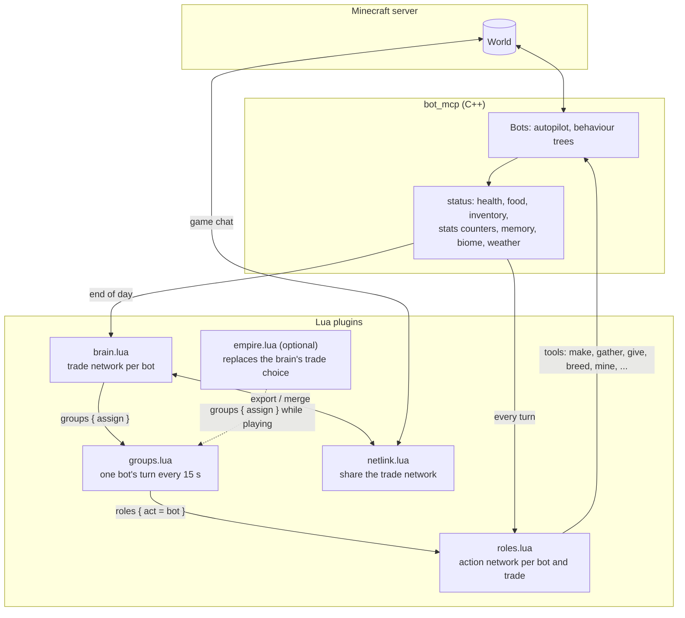
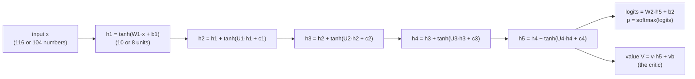
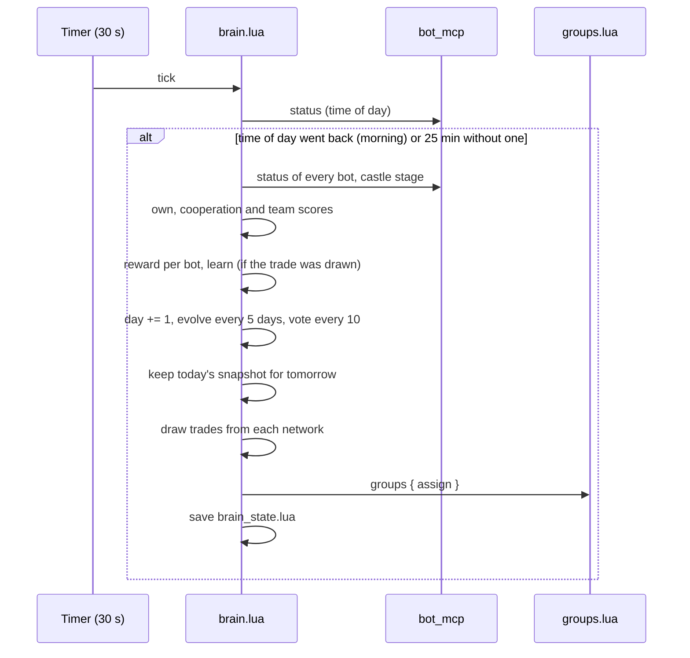
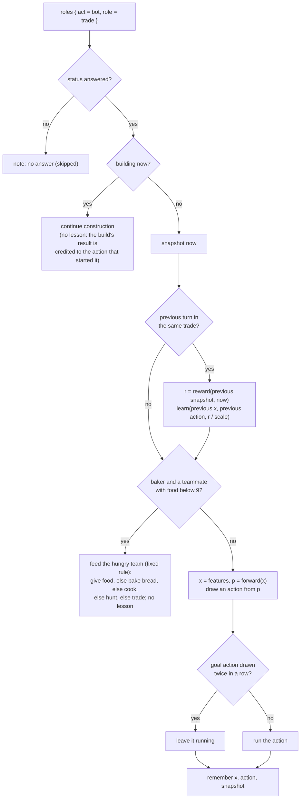
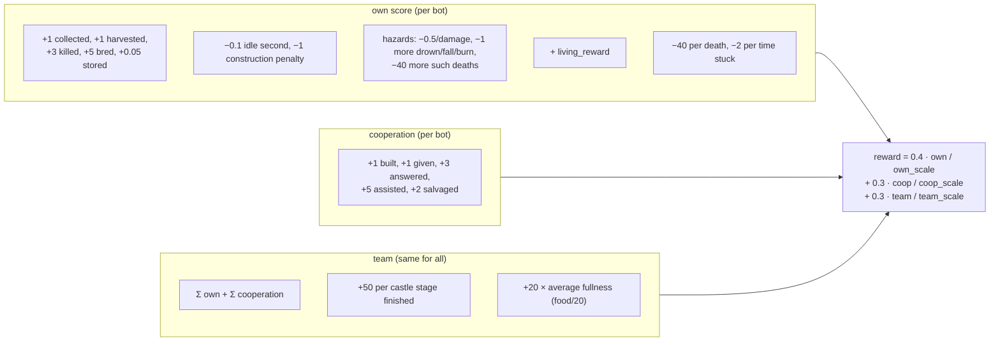
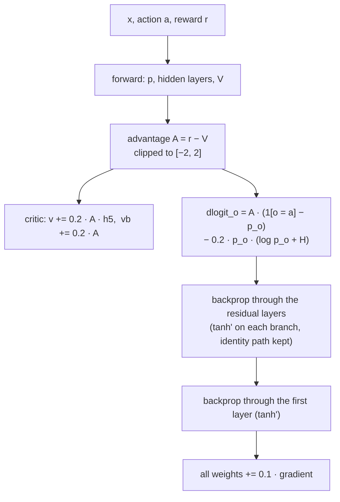
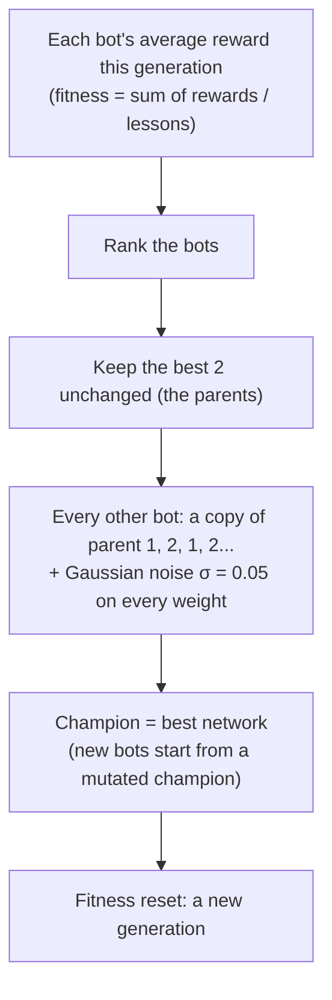
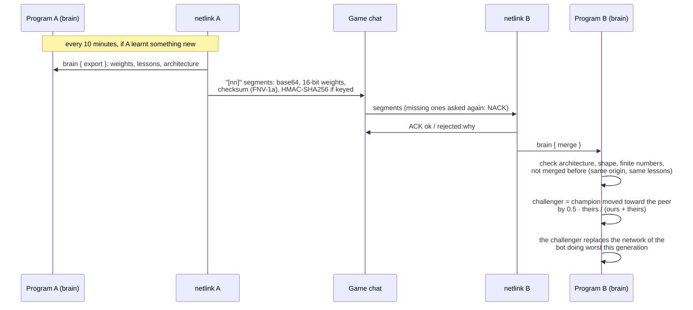

# The bots' neural networks

How the bots decide what to do, what they are rewarded and penalized for, and how they get better.
Everything here is read from the code: `bot/plugins/brain.lua` (trade selection, leader vote, evolution,
peer merging), `bot/plugins/roles.lua` (actions within a trade), `bot/plugins/groups.lua` (turns),
`bot/plugins/netlink.lua` (sharing between programs) and the counters kept by `bot/mcp.cpp`.
Game version assumed: Minecraft Java 26.3 (the version Botcraft is built against here).

## Contents

1. [Overview](#1-overview)
2. [The network itself](#2-the-network-itself)
3. [The trade network (brain)](#3-the-trade-network-brain)
4. [The action networks (roles)](#4-the-action-networks-roles)
5. [Rewards and penalties](#5-rewards-and-penalties)
6. [How the networks learn](#6-how-the-networks-learn)
7. [Evolution between bots](#7-evolution-between-bots)
8. [The leader vote](#8-the-leader-vote)
9. [Sharing between programs (netlink)](#9-sharing-between-programs-netlink)
10. [Saving, upgrading, rolling back](#10-saving-upgrading-rolling-back)
11. [Tools, panels and tests](#11-tools-panels-and-tests)
12. [Constants](#12-constants)
13. [Known limits and quirks](#13-known-limits-and-quirks)

---

## 1. Overview

There are two kinds of network. Both are small multilayer perceptrons written in plain Lua, with no
libraries, and trained online while the bots play.

| | Trade network (brain) | Action networks (roles) |
|---|---|---|
| Decides | which **trade** a bot has (baker, miner, ...) | which **action** a bot takes next, within its trade |
| How many | one per bot | one per bot **per trade** (11 trades) |
| Inputs | 116 | 104 |
| Hidden | 5 layers of 10 units (1 + 4 residual) | 5 layers of 8 units (1 + 4 residual) |
| Outputs | 11 trades (softmax) | that trade's actions, 15 to 28 (softmax) |
| Critic | linear value head | linear value head |
| Decides every | Minecraft day (when a day ends) | bot turn (one bot every 15 s, round robin) |
| Learns from | the day's own work, cooperation and team result | what the bot achieved since its previous turn |
| Evolution | every 5 days, best 2 of all bots | every 5 days, best 2 per trade |
| Saved in | `bot/brain_state.lua` | `bot/roles_state.lua` |



The brain decides who works in which trade. The groups plugin then gives the bots turns, one every 15
seconds in round robin. At each turn the bot's own action network for its trade picks an action, and the
action runs through the program's tools. At the bot's next turn, what it achieved in between is the reward
for that action. At the end of each Minecraft day, what every bot and the team achieved is the reward for
the trade choices.

---

## 2. The network itself

Both kinds use the same code, the global `NN` table defined in `brain.lua`, with different sizes.

### Architecture



- **First layer:** a dense layer with tanh, written as `2 / (1 + e^(-2s)) - 1`, which is tanh.
- **Four residual layers:** `h ← h + tanh(U·h + c)`, square (10×10 or 8×8). They start at zero, so a new or
  upgraded network starts as the identity: adding layers didn't change what older networks had learnt.
- **Policy head:** a linear layer and a softmax, which gives the probability of each trade or action. The
  bot **draws** from these probabilities instead of taking the largest, so it keeps trying everything.
- **Critic head:** a linear value `V(x)`, the reward a situation like this usually brings. It reads the last
  hidden layer, but its error is not backpropagated into the hidden layers.

### Size

| Network | Weights and biases |
|---|---|
| Trade network | 116×10+10 (first) + 4×(10×10+10) (residual) + 11×10+11 (policy) + 10+1 (critic) = **1,742** |
| Action network with A actions | 104×8+8 + 4×(8×8+8) + 8A+A + 8+1 = **1,137 + 9A** (1,272 to 1,389) |

### Initialization

- Weights are uniform in ±0.3 from a fixed linear congruential generator. The trade network uses seed 12345
  and trade *i* of the action networks uses seed 1000+i. The same code always starts from the same network.
- Biases, the residual layers and the critic start at 0.
- A bot that joins gets a **mutated copy of the champion**, the best network of the last generation, rather
  than a blank one. Mutation is described in [section 7](#7-evolution-between-bots).

---

## 3. The trade network (brain)

### Inputs (116)

| # | Input | Value |
|---|---|---|
| 1 | bias | 1 |
| 2 | health | health / 20 |
| 3 | food level | hunger bar / 20 |
| 4 | air | air / 300, clamped to 0..1 |
| 5 | pos x | tanh(x / 500) |
| 6 | pos y | (y + 64) / 384, clamped |
| 7 | pos z | tanh(z / 500) |
| 8 | night | 1 if time of day ≥ 13000 |
| 9 | needs unmet | 1 − (food carried + wood carried + stone carried + has pickaxe + has axe) / 5 |
| 10 | team hungry | share of bots with hunger ≤ 8, at the last assignment |
| 11 | castle progress | castle stages finished yesterday / 5, max 1 |
| 12 | building | 1 if it has a build order under way |
| 13 | build remaining | blocks left / 1000, max 1 |
| 14 | build idle | seconds since the build last progressed / 600, max 1 |
| 15 | has objective | 1 if building, gathering, making something or under a team order |
| 16 | armor worn | armor pieces worn / 4 |
| 17 | gear quality | sum of the best tier per tool and armor kind / 45 (wood/leather/gold 1, stone/chain 2, iron 3, diamond 4, netherite 5) |
| 18–21 | has pickaxe, axe, sword, hoe | 0 or 1 |
| 22 | food carried | edible items / 16, max 1 |
| 23 | food variety | kinds of food carried / 8, max 1 |
| 24 | wood carried | logs and planks / 64 |
| 25 | stone carried | cobblestone and stone / 64 |
| 26 | iron carried | iron ingots and raw iron / 16 |
| 27 | coal carried | coal and charcoal / 16 |
| 28 | hostiles near | hostile mobs within 16 blocks / 4 |
| 29 | animals near | animals within 16 blocks / 8 |
| 30 | players near | players within 16 blocks / 4 (if none, the online players other than itself) |
| 31 | chest resources | items known to be stored in chests / 256 |
| 32 | furnaces known | remembered chests, barrels, furnaces, smokers and crafting tables / 10 |
| 33 | world resources | other remembered places (ores, logs, crops, animals...) / 50 |
| 34–44 | was baker ... was carpenter | one-hot of the trade it had (11) |
| 45 | time of day sine | sin(2π·time/24000) |
| 46 | time of day cosine | cos(2π·time/24000) |
| 47 | rain strength | 0..1 |
| 48 | thunder strength | 0..1 |
| 49 | biome unknown | 1 if the biome is none of the 67 below |
| 50–116 | biome *name* | one-hot over the 67 Java 26.3 biomes, in a fixed order that new biomes are appended to |

### Outputs (11 trades)

`bakers, farmers, butchers, miners, builders, soldiers, blacksmiths, explorers, fishers, lumberjacks,
carpenters`, in this order. The order never changes; newer trades were appended.

### Assigning the trades

Trades are assigned once all the bots are in (2.5 minutes after loading), then each morning:

1. Each bot's network gives `p` from its inputs, and the bot **draws** a trade from `p`. How sure it is
   is `p[drawn]`.
2. The surest bots are placed first. A bot that **already has a trade keeps it**. The elected leader is a
   builder and the berry picker a farmer.
3. Every other bot gets the trade it drew if that trade has room. Each trade holds at most
   `ceil(bots / 11)`. Otherwise it gets its next most wanted trade with room, and builders as a last resort.
4. The groups go to `groups { assign = ... }`. The groups plugin gives each bot its trade, and the
   miners form one mining team.
5. The day's input `x` and trade are kept for the evening's lesson. The lesson is learnt only if the trade
   the bot has **is the one it drew that morning** (`state.drawn`): a trade it was given for lack of room
   says nothing about what it wants.

When the empire plugin plays, it stops the brain and decides the trades itself. The action networks keep
learning.



---

## 4. The action networks (roles)

### Inputs (104)

These are the trade network's inputs without *castle progress* and the 11 *was trade* inputs, with two
differences:

- **needs unmet** is the trade's own: the average over the items the trade wants to carry of
  `max(0, wanted − carried) / wanted` (the `NEEDS` table below).
- **team hungry** is the larger of the bot's own hunger, `(14 − food) / 14`, and the share of
  teammates with food ≤ 12.

That makes 32 inputs about the bot plus the 72 environment inputs (5 + 67 biomes) = 104.

### Turns

The groups plugin gives one bot a turn every 15 seconds, round robin over every bot in a trade. At its
turn:



Actions marked with \* below are **goals**: they set something the bot then works on by itself (gathering,
a mining team, making 64 of something). If the same goal is drawn again on the next turn, it keeps
running rather than starting over.

### The trades: actions and what counts

The reward weights are per trade and apply to what changed since the bot's previous turn. They are
explained in [section 5](#5-rewards-and-penalties).

| Trade | Reward weights | Actions (in output order) |
|---|---|---|
| bakers (23) | given 2, made 1, needs 4 | bake bread, bake pumpkin pie, bake a cake, feed the hungriest, trade, store, cook available food, *common*, cook baked_potato, cook beetroot_soup, cook mushroom_stew, cook rabbit_stew, cook cookie |
| farmers (28) | harvested 1, given 1, collected 0.2, built 2, bred 5, needs 4 | harvest, make a farm, collect eggs, milk cows, gather pumpkins, trade, store, *common*, gather planting seeds\*, build animal pen, gather cow, breed cow, gather sheep, breed sheep, gather pig, breed pig, gather chicken, breed chicken |
| butchers (20) | bred 5, killed 2, made 0.5, given 0.5, needs 4 | breed cows, breed sheep, breed pigs, breed chickens, slaughter, cook meat, shear sheep, trade, store, *common* |
| miners (19) | collected 1, stored 0.05, needs 4 | mine coal\*, mine iron\*, mine copper and gold\*, mine deep ores\*, trade, store, gather construction stone\*, gather construction logs\*, *common* |
| builders (18) | built 1, collected 0.2 | build the castle, fetch stone\*, fetch wood\*, store, gather construction stone\*, gather construction logs\*, make storage chests\*, *common* |
| soldiers (15) | killed 3, assisted 5, answered 3 | hunt hostiles\*, guard the leader\*, gear up, store, *common* |
| blacksmiths (22) | given 3, made 1, needs 4 | smelt iron, make tools, make armor, make buckets, make torches\*, hand out tools, trade, store, make storage chests\*, make building axes\*, hand out axes, *common* |
| explorers (16) | collected 0.3, explored 1 | seek other woods\*, seek sand and clay\*, seek pumpkins, melons, cane\*, wander, store, *common* |
| fishers (16) | fished 2, made 1, given 1, needs 2 | fish, cook fish, feed the hungriest, trade, store, *common* |
| lumberjacks (15) | collected 1, given 2, stored 0.05, built 1, needs 4 | fell trees\*, make an axe, trade, store, *common* |
| carpenters (21) | made 1, built 2, given 2, needs 4 | trade, store, craft oak_planks, chest, barrel, oak_stairs, oak_fence, oak_pressure_plate, oak_door, stick, *common* |

*common* is the same 11 actions in every trade: decorate home, upgrade tools, upgrade armor, move, hunt,
mine\*, eat, craft, rest, sleep, help other players.

New actions are always appended, so a saved network's output *n* keeps meaning the same action.

### The exchange between trades ("trade" action)

Each trade wants to carry some things (`NEEDS`), and each item is made by one trade (`PROVIDES`):

| Trade | Wants to carry |
|---|---|
| builders | 16 logs, 32 cobblestone, 2 chests, 4 bread |
| lumberjacks | a stone axe, 4 bread |
| carpenters | 16 logs, 4 bread |
| bakers | 9 wheat, 2 eggs, 3 milk buckets, 2 pumpkins |
| farmers | a bucket, 4 bread |
| butchers | 8 wheat, 8 wheat seeds, 4 carrots, 4 bread |
| miners | an iron pickaxe, 16 torches, 4 bread |
| blacksmiths | 9 raw iron, 8 coal, 4 leather, 4 bread |
| fishers | 4 coal, 2 bread |

When the "trade" action runs:

1. For each item the bot lacks, it asks a bot of the trade that makes it to hand over its spare, which is
   whatever that bot carries beyond its own trade's needs.
2. Otherwise it gives its own spare to the bot of another trade that lacks it most. Builders with an
   active build count too.

The *needs* reward rewards getting what the trade lacks, either way.

---

## 5. Rewards and penalties

### Where the numbers come from

The C++ program keeps counters for each bot and shows them as `stats` in its status:

| Counter | Grows when the bot... |
|---|---|
| `collected` | fells a tree (per log) or gathers a block |
| `harvested` | harvests a ripe crop |
| `killed` | kills a mob |
| `bred` | breeds two animals |
| `stored` | puts items in a chest (per item) |
| `given` | hands items to another bot (per item) |
| `built` | places or clears a block of a build plan |
| `fished` | catches a fish (per catch) |
| `answered` | comes when called to a fight |
| `assisted` | kills something in a fight it was called to |
| `salvaged` | picks up a fallen teammate's things |
| `idle_seconds` | spends time idle with its autopilot on (sleeping, working in place and paused bots do not count) |
| `construction_penalty` | builds badly: 10 per chest placed facing differently from the chest beside it; 10 per cramped mine slice (under 3 wide or 3 high); 5 per mine step up or down without a stair block (tunnels are now dug 3 wide and 3 high with a cobblestone stair on every step, so these come from running out of cobblestone or from unsafe side lanes); 10 per one-block-wide road cell; twice the plan's block count for a finished roofed building with no walkable way in |
| `damage_taken` | loses health, per point, from any cause |
| `drown_damage`, `fall_damage`, `burn_damage` | loses health to drowning, a fall (or stalagmite), or fire, lava, magma or a campfire, per point, within 2 seconds of the hit that caused it |
| `drown_deaths`, `fall_deaths`, `burn_deaths` | dies within 2 seconds of such a hit |

The status also gives `deaths` and `times_stuck`, plus health, hunger, inventory and equipment, which are
used for the *condition* below.

Every term uses the **growth** of a counter since the last snapshot. A counter that went down was reset by
a restart, so all of its current value counts as new.

### The condition reward (both networks)

`NN.condition` summarizes a bot from its status:
- **variety:** kinds of food carried.
- **quality:** sum of the best tier per tool or armor kind.
- **health** and **food** (the hunger bar).
- **has_food:** 0 or 1.
- **missing:** how many of the **four essentials** it lacks. The essentials are food, a pickaxe or
  shovel, a sword or axe, and any armor piece.

`NN.living_reward(before, now)` then adds, with `d = min(elapsed seconds, 300) / 300`:

| Term | Effect |
|---|---|
| `+ d · min(health, food) / 20` | staying alive and well, **only if it did not die** in between |
| `+ 2 · Δvariety` | each new kind of food carried |
| `+ 3 · Δquality` | each better tool or armor tier |
| `+ 6 · Δhas_food` | getting food (+6) or running out of it (−6), as much as a stone tool |
| `− 0.5 · d · missing` | each missing essential, as long as it is missing |
| `− 2 · d · (1 − health/20)` | low health, as long as it lasts (up to −2) |
| `− 2 · d · (1 − food/20)` | hunger, as long as it lasts (up to −2) |
| `+ Δhealth / 4 + Δfood / 4` | healing and eating; losing health or hunger costs the same |

### The hazards (both networks)

`NN.hazards`: −0.5 per point of damage from any cause. Drowning, falls and fire or lava cost **−1 more per
point**, and dying of one of those costs **−40 more**, on top of the −40 every death costs.

### Action network reward (per turn)

```
r =  Σ trade weight × growth of its counter        (table in section 4; "made", "needs" and "explored" below)
   − growth of construction_penalty
   − 0.1 × growth of idle_seconds                  (1 point per 10 idle seconds)
   + Σ hazard weight × growth of its counter
   + living_reward(previous condition, condition now)
   − 40 × new deaths − 2 × new times stuck
```

- **made:** growth in the count of crafted things carried (planks, chests, barrels, stairs, fences, doors,
  plates, bookshelves, carpets, lanterns, torches, iron ingots, bread, pies, cakes, buckets, leather, shears,
  cooked food, and every tool and armor piece).
- **needs:** how much of what its trade lacks it got (`unmet before − unmet now`, 0..1, times the weight).
- **explored:** 5 per new kind of remembered place, plus 1 per 100 more remembered places.

Before learning, `r` is divided by the trade's running reward size (`scale ← 0.9·scale + 0.1·max(1, |r|)`,
starting at 5), so the rewards stay near ±1.

### Trade network reward (per day)



The three scales are running averages (`0.9·old + 0.1·new`, at least 1): the average own score per bot,
the average cooperation per bot, and the size of the team score. Each part therefore weighs about the same
whatever the number of bots or the size of a typical day.

### Summary: rewarded and penalized

| Rewarded | Penalized |
|---|---|
| Gathering, harvesting, killing, breeding, storing, fishing | Every death: −40, and −40 more for drowning, falling or burning to death |
| Building (blocks placed or cleared for a plan) | Each point of health lost: −0.5, −1 more from drowning, falls, fire or lava |
| Giving items, coming to fights and killing there, saving a fallen teammate's things | Low health and hunger, as long as they last |
| The trade's own work: crafted items, what the trade lacked obtained, places discovered | Lacking food, a mining tool, a weapon or armor, as long as it lacks it |
| New food kinds, better gear, getting food, healing, eating | Running out of food (−6), losing gear tiers |
| Staying alive and well | Idle time with autopilot on: −1 per 10 seconds |
| Castle stages finished, a well-fed team (team part) | Getting stuck: −2 each |
| | Construction defects: misaligned chests, one-wide mines and roads, buildings with no way in |

---

## 6. How the networks learn

One step of **advantage actor-critic** (`NN.learn`), plain stochastic gradient, one sample at a time:



- **Advantage:** the reward minus what the critic expected from such a situation. A choice is reinforced
  only when it did better than usual there. The clip to ±2 keeps one odd day or turn from swinging the
  network.
- **Policy gradient:** this is gradient ascent on `A · log p(a) + 0.2 · H(p)`. The first part makes the
  chosen output more likely when the advantage is positive and less likely when negative. The second is
  the **entropy bonus** (`H = −Σ p log p`), which keeps some doubt: a bot certain of one choice would never
  try the others.
- **Critic:** moves toward the reward at rate 0.2, on the last hidden layer only.
- **Exploration:** besides the entropy bonus, every decision is **drawn** from `p`. A 20% choice is taken
  about once in five.
- **Learning rate:** 0.1 for the policy and every hidden layer.

**When** each network learns:
- **Trade network:** once a day per bot, from that morning's input and trade, if the trade was drawn
  (section 3).
- **Action network:** at every turn, from the previous turn's input and action, if the previous turn was in
  the same trade. A turn spent building is skipped, so the next lesson covers the whole build and credits
  (or penalizes) the action that started it.

---

## 7. Evolution between bots

On top of each bot's own learning, a small genetic algorithm runs every **5 game days**:



- **Trade network:** one population, all the bots' networks. Every 5 days of the brain's day count.
- **Action networks:** one population per trade, every 5 days of the roles plugin's own day count. Only
  bots that played that trade compete, because different trades have different actions. It runs in empire
  mode too.
- Only bots with at least one lesson in the generation are ranked. A bot with none is still replaced by a
  parent's copy.
- Each action network's in-flight lesson is dropped when it is replaced, since the old network's previous
  action means nothing to the new one.
- Noise uses the Box–Muller method from `math.random`.

So good behaviour spreads in two ways: each bot learns from its own experience (reinforcement), and the
best bots' networks replace the worst ones' (selection).

---

## 8. The leader vote

Every 10 days, using the last 10 days of history:

- For each candidate:
  - `own` is the sum of its own scores.
  - `coop` is its cooperation.
  - `lead` is the average team score on days it led, or the overall average if it never led.
- Each is turned into a z-score across the candidates (`(value − mean) / spread`).
- Each voter scores every candidate:
  `0.35·z(own) + 0.35·z(coop) + 0.3·z(lead)`, plus **0.5** if it is the current leader and the team did
  at least as well in the second half of the 10 days as in the first, plus a little noise in ±0.3 (each
  voter's own judgement).
- Each voter votes for its best candidate. Most votes wins; a tie keeps the current leader.
- The winner leads the team (the `leader` tool), becomes a builder, and the result is said in the chat:
  `[vote] day N: BotX stays/is the new leader with V of N votes`.

The vote is not a neural network. It uses the same scores the trade network learns from.

---

## 9. Sharing between programs (netlink)

Programs on other computers whose bots play on the same server can pool what their trade networks learnt.
They do it through the only thing they share, the game chat:



The merged network does not replace the champion directly. It becomes the network of the bot doing worst,
and evolution decides: it spreads if it wins a generation and is replaced like any other if not. A network
with another architecture string (`brain:116x10x10x10x10x10x11+critic:environment:v7`) is always rejected.
Only the trade network is shared, not the action networks.

---

## 10. Saving, upgrading, rolling back

- **Files:** `bot/brain_state.lua` and `bot/roles_state.lua`, Lua tables written after every day or
  turn. Learning continues across restarts. Git ignores both.
- **Growing:** when inputs or outputs are added (new biomes, new trades, new actions), `NN.grow` keeps
  every learnt weight. New inputs start at zero weight and new outputs small. Missing residual layers are
  added as zeros (`NN.deepen`), so an old network behaves as before until it learns.
- **Checkpoints:** the trade champion of the last **3 mornings** is kept. `brain { rollback = n }` gives
  every bot the network of *n* mornings ago and resets the generation's fitness.

---

## 11. Tools, panels and tests

| Call | What it gives |
|---|---|
| `brain {}` | day, lessons learnt, generation, leader, last vote, each bot's trade, wants (%) and last reward |
| `brain { network = "Bot3" }` | that bot's trade network: inputs with names and values, hidden activations, outputs, critic value, all weights, plus its current action network |
| `brain { vote = true }` | vote now |
| `brain { stop = true }`, `brain { start = true }` | pause or resume the trade choice (the groups stay) |
| `brain { export = true }`, `brain { merge = ... }` | for netlink |
| `brain { rollback = 1..3 }` | back to an earlier morning's network |
| `roles {}` | for every trade: each action, how often it was drawn, its running average reward |
| `roles { network = "miners", bot = "Bot3" }` | the bot's network for that trade and what it makes of the bot now |
| `roles { act = "Bot3", role = "miners" }` | a turn (what the groups plugin calls) |

The web panel and the terminal panel (`bot_tui`) both draw a bot's networks, with layer activations and
output probabilities, from `brain { network = ... }`.

Offline tests, each run from an empty temporary directory:

| Test | Checks |
|---|---|
| `lua5.4 test_brain.lua plugins/brain.lua` | 15 bots where miners earn most come to want mining more; a leader is elected and announced; networks are saved; merges are checked (NaN, other architecture, duplicates) and become a challenger; generations run; rollback |
| `lua5.4 test_roles.lua plugins/brain.lua plugins/roles.lua` | a miner whose iron trips pay comes to prefer mining iron |
| `lua5.4 test_neural.lua plugins/brain.lua` | five hidden layers; backpropagation matches a numerical gradient of the policy and entropy at every layer; every layer learns; outputs sum to 1 and stay finite |
| `lua5.4 test_quality_rewards.lua plugins` | construction penalties and idle time in both networks, delayed construction credit, food as an essential, low health and hunger, damage, drowning and burning |

---

## 12. Constants

| Constant | Value | Where |
|---|---|---|
| Trade network inputs, hidden, outputs | 116, 10, 11 | `brain.lua` `IN, HID, OUT` |
| Residual layers | 4 | `EXTRA_LAYERS` (both networks) |
| Action network hidden units | 8 | `roles.lua` `HID` |
| Learning rate | 0.1 | `LEARNING_RATE` |
| Critic rate | 0.2 | `VALUE_RATE` |
| Entropy bonus | 0.2 | `ENTROPY` |
| Advantage clip | ±2 | `NN.learn` |
| Generation length | 5 days | `GENERATION_DAYS`, roles' day clock |
| Mutation | σ = 0.05 | `MUTATION` |
| Parents kept | 2 | `evolve_population` |
| Leader vote | every 10 days | `VOTE_EVERY` |
| Reward mix (trade network) | 0.4 own, 0.3 cooperation, 0.3 team | `end_of_day` |
| Death | −40 | both |
| Stuck | −2 | both |
| Idle | −0.1 per second | both |
| Turn | one bot every 15 s | `groups.lua` |
| Day without a clock | 25 minutes | both day clocks |
| Checkpoints | 3 mornings | `end_of_day` |

---

## 13. Known limits and quirks

- **Turns get rare with many bots.** One turn every 15 seconds in round robin means each of 100 bots
  decides about every 25 minutes. Its action network learns about two to three times per in-game hour,
  and a reward covers everything the bot did in those 25 minutes, not only the action drawn.
- **The time-based condition terms cap at 5 minutes.** `living_reward` scales its "as long as it lasts"
  terms by `min(elapsed, 300 s) / 300`. In the trade network, which compares a whole day (20 minutes), a
  day of hunger costs no more than 5 minutes of it.
- **Trades are kept.** Once assigned, a bot keeps its trade for good. The trade network keeps drawing
  every morning, but only learns on days when its draw matches the trade it has. So it learns slowly when
  its wants differ from its trade.
- **The critic does not shape the hidden layers.** Only the actor's gradient trains them, and the critic
  reads them as they are.
- **Two separate day clocks.** The brain and the roles plugin each count days, so their generations need
  not fall on the same day.
- **Out-of-date comments.** The header of `brain.lua` says the reward is half own work and half the team's
  (the code uses 40/30/30), and the header of `roles.lua` says three hidden layers and 20 inputs (the code
  has 5 layers and 104 inputs). This document follows the code.
- **Chat use.** netlink sends one chat line every 2 seconds at most while sharing a network. That is under
  the server's spam limit for one sender, but it adds to the bots' own team chat. Some `disconnect.spam`
  kicks in the log may come from the two together.
